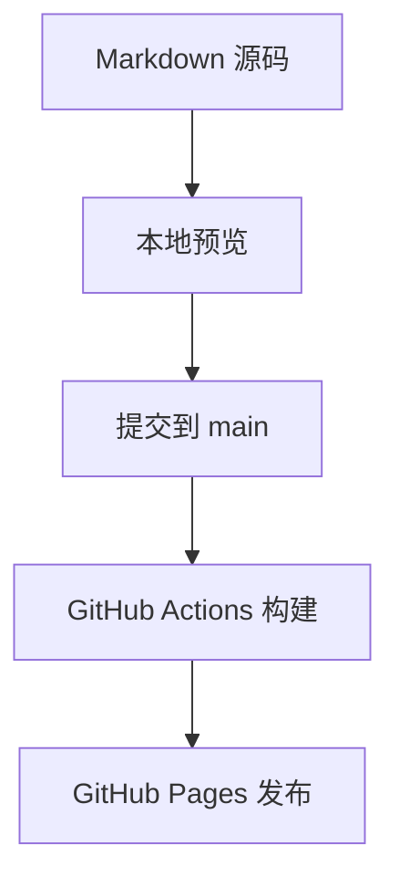

一份用于检查中英文混排、代码高亮、LaTeX 公式、表格与流程图的示例。所有内容只用于展示博客能力。

<!-- more -->

## 中英文混排

研究笔记常在中文解释中使用 Machine Learning、Computer Vision 和 Large Language Models 等术语。正文保持宽松行距，英文代码使用等宽字体，比如 `torch.nn.Module`。

**加粗表示重点**，*斜体表示强调*，~~删除线表示修订~~。外部引用可以链接到 [Hexo 官方文档](https://hexo.io/docs/)。

## 数学公式

行内数学用 `$...$`：$E=mc^2$。也支持括号形式：\(a^2+b^2=c^2\)。

块公式使用单独的 `$$` 行：

$$
\operatorname{Attention}(Q,K,V)=\operatorname{softmax}\left(\frac{QK^{\mathsf{T}}}{\sqrt{d_k}}\right)V
$$

$$
A=\begin{bmatrix}1 & 2\\3 & 4\end{bmatrix},\qquad
\int_0^1 x^2\,\mathrm{d}x=\frac{1}{3}
$$

## 代码与复制

```javascript
const note = {
  topic: 'Research notes',
  status: 'example',
};
console.log(`${note.topic}: ${note.status}`);
```

```powershell
npm.cmd run draft -- "我的第一篇笔记"
npm.cmd run dev
```

代码不会作为网页脚本执行。特殊字符示例：

```html
<script>alert("This is escaped example code")</script>
```

## 表格与引用

| 内容形式 | 推荐一级分类 | 标签示例 |
| :--- | :--- | :--- |
| 基础概念与推导 | 技术学习 | ML、DL、CV、NLP |
| 论文拆解与复现笔记 | 论文阅读 | LLM、Multimodal、论文笔记 |
| 实验与问题记录 | 科研记录 | RL、AI Agents、复现 |
| 软件实现与项目复盘 | 工程实践 | Python、工具开发 |
| 课程、学习方法与成长 | 学习与成长 | 学习记录、保研 |

> 上表是写作建议，分类与标签只在有实际文章时生成，网站不会预先建立一堆空栏目。

## 流程图



## 本地图片

下面是为此博客原创绘制的 SVG 示意封面，可替换成你有使用权的本地图片。


## 导航

桌面用右侧固定目录，手机与平板用顶部目录按钮在本篇内跳转。底部可返回[欢迎示例](/posts/welcome/)，也可以访问[分类](/categories/)与[标签](/tags/)。
